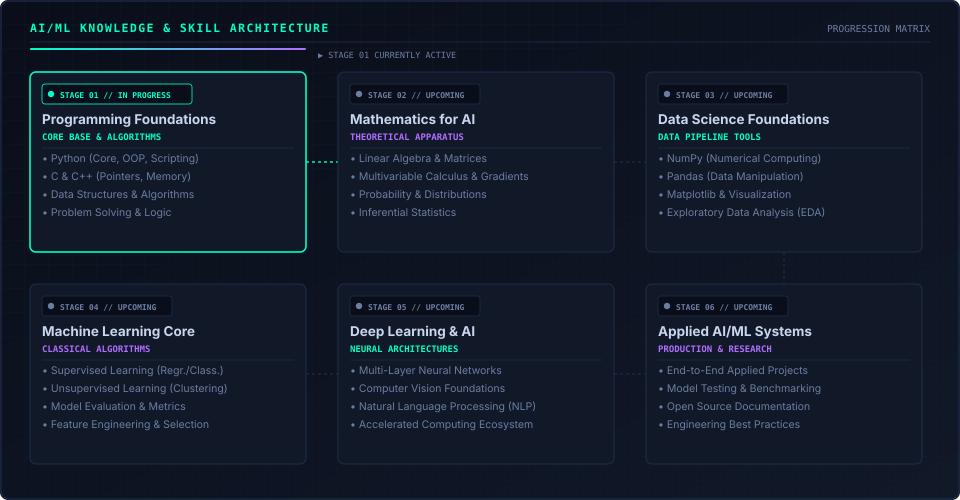

<!-- HERO BANNER -->

 

<!-- SYSTEM TELEMETRY STRIP -->

  <code>SYSTEM // ACADEMIC PROFILE</code> &nbsp;|&nbsp;
  <code>STATUS: ACTIVE_LEARNER</code> &nbsp;|&nbsp;
  <code>DISCIPLINE: AI &amp; ML</code> &nbsp;|&nbsp;
  <code>FOCUS: ADVANCED COMPUTING</code>

---

### // 01. ABOUT ME

I am an undergraduate student pursuing a <strong>Bachelor of Technology in Computer Science and Engineering with a specialization in Artificial Intelligence and Machine Learning</strong>.

My academic and technical trajectory is centered on mastering foundational computer science, investigating the mathematics and algorithms behind modern artificial intelligence, and building practical software solutions. I approach engineering with curiosity, analytical rigor, and an ongoing commitment to writing clean, structured code.

<!-- Core Focus Areas Table -->
| Engineering Pillar | Focus &amp; Exploration | Current Trajectory |
| :--- | :--- | :--- |
| **Artificial Intelligence** | Intelligent systems, search mechanics, heuristic evaluation, and computational modeling | Theoretical Study &amp; Academic Exploration |
| **Machine Learning** | Statistical learning algorithms, data preparation, evaluation metrics, and supervised methods | Foundational Curricula &amp; Research |
| **Software Development** | Structured procedural and object-oriented programming, algorithm efficiency, and memory principles | Python, C, C++ Foundation |
| **Web Technologies** | Client-side markup, accessibility, structural layout, and responsive interface styling | HTML5, CSS3 Interface Prototyping |

---

### // 02. TECHNICAL SKILLS

The following technologies represent my active programming foundation. In adherence to strict professional integrity, only languages and tools currently in active, verified usage are presented. Advanced frameworks and libraries are mapped in the learning roadmap below.

<table>
  <tr>
    <td align="center" width="180" height="125">
        
      <strong>Python</strong> 
      Core Syntax &amp; Scripting
    </td>
    <td align="center" width="180" height="125">
        
      <strong>C</strong> 
      Procedural &amp; Memory Basics
    </td>
    <td align="center" width="180" height="125">
        
      <strong>C++</strong> 
      OOP &amp; Data Structures
    </td>
    <td align="center" width="180" height="125">
        
      <strong>HTML5</strong> 
      Semantic Web Architecture
    </td>
    <td align="center" width="180" height="125">
        
      <strong>CSS3</strong> 
      Responsive Layouts &amp; Styling
    </td>
  </tr>
</table>

---

### // 03. FEATURED PROJECT — CAMPUSFIND

  

 

**CampusFind** is a dedicated campus lost-and-found web portal engineered to address everyday misplaced item challenges across university grounds.

- **System Purpose**: Establish an intuitive, centralized portal where students, staff, and faculty can report misplaced property, catalog recovered items, filter records by location and time, and coordinate safe retrieval.
- **Architectural Scope**: Structured client-side architecture focusing on clean user flows, accessibility, and intuitive catalog presentation.
- **Current Technology Stack**: HTML5, CSS3, Responsive Design.
- **Development Lifecycle**: In Active Development (`Coming Soon`).
- **Source Repository**: `[COMING SOON // PLACEHOLDER: https://github.com/anshuldh2025-eng/campusfind]`
- **Live Deployment**: `[COMING SOON // SCHEDULED UPON REPOSITORY RELEASE]`

---

### // 04. MY AI/ML VISION

  

 

My ambition is to evolve into a proficient **AI/ML Engineer**, contributing to computational intelligence frameworks, high-performance algorithms, and scalable intelligent systems.

- **Foundational Rigor**: Building a rock-solid comprehension of multivariable calculus, linear algebra, probability, and optimization functions that govern neural transformations.
- **Deep Representation Modeling**: Understanding how latent spaces capture multi-dimensional representations and facilitate complex decision boundaries.
- **Advanced Computing Ecosystem**: Highly inspired by the frontier of accelerated computing, parallelized tensor execution, and hardware-software co-design—particularly the computing ecosystem pioneered by NVIDIA. *(Note: Independent academic study; no institutional or corporate affiliation.)*
- **Engineering Discipline**: Ensuring that theoretical innovations are translated into clean, testable, and maintainable production codebases.

---

### // 05. AI/ML LEARNING ROADMAP

  

 

| Stage | Academic &amp; Technical Phase | Status | Core Curriculum &amp; Competencies |
| :---: | :--- | :---: | :--- |
| **01** | **Programming Foundations** | `[IN PROGRESS]` | Python fundamentals, C/C++ memory semantics, algorithmic complexity, core data structures |
| **02** | **Mathematics for AI** | `[UPCOMING]` | Linear algebra (eigenvalues, vectors, SVD), multivariable calculus, probability theory, statistics |
| **03** | **Data Science Foundations** | `[UPCOMING]` | NumPy vectorization, Pandas data structures, Matplotlib visualization, exploratory data analysis |
| **04** | **Machine Learning Core** | `[UPCOMING]` | Supervised &amp; unsupervised algorithms, cost function optimization, regularization, evaluation metrics |
| **05** | **Deep Learning &amp; AI** | `[UPCOMING]` | Perceptrons, backpropagation, CNNs for computer vision, RNNs/Transformers for NLP |
| **06** | **Applied AI/ML Systems** | `[UPCOMING]` | End-to-end projects, performance profiling, open-source publication, production standards |

---

### // 06. GITHUB ANALYTICS

The telemetry cards below reflect live GitHub repository statistics and language distributions once connected to an active GitHub username.

<!-- GitHub Readme Stats (Custom midnight navy palette: #0B1020, #00D4FF, #8B5CF6, #E6EDF7, #253047) -->

&nbsp;

  

<!-- GitHub Streak Stats (Custom palette matched to #0B1020) -->

> **Telemetry Note**: The cards above fetch public telemetry dynamically via GitHub's API. Replace `anshuldh2025-eng` with your confirmed GitHub handle across all URLs. If a third-party analytics provider experiences brief latency, profile readability remains completely intact.

---

### // 07. LET'S CONNECT &amp; BUILD SOMETHING MEANINGFUL

I am open to academic discussions, collaborative learning opportunities, and technical mentorship.

<table>
  <tr>
    <td align="center" width="260">
      <a href="mailto:anshuldh2025@gmail.com">
        <strong>EMAIL</strong> 
        <code>anshuldh2025@gmail.com</code>
      </a>
    </td>
    <td align="center" width="260">
      <a href="https://www.linkedin.com/in/anshul-dhiman-28959541a/">
        <strong>LINKEDIN</strong> 
        <code>in/anshul-dhiman-28959541a</code>
      </a>
    </td>
    <td align="center" width="260">
      <a href="https://github.com/anshuldh2025-eng">
        <strong>GITHUB</strong> 
        <code>github.com/anshuldh2025-eng</code>
      </a>
    </td>
  </tr>
</table>

 

  Engineered for Anshul Dhiman // Designed with authentic precision. No emojis. All rights reserved.

