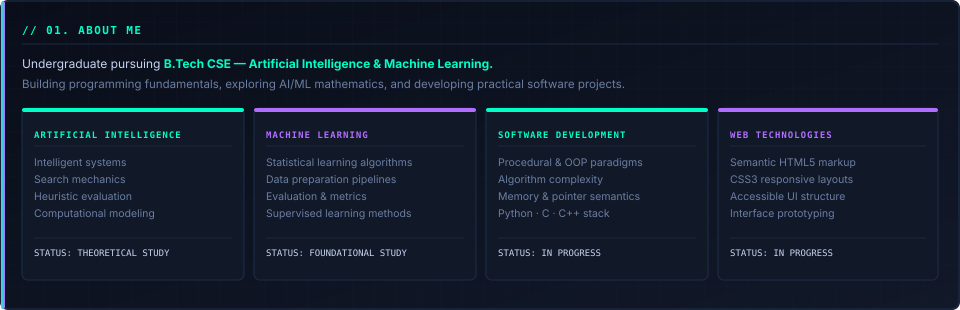
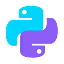
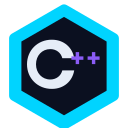
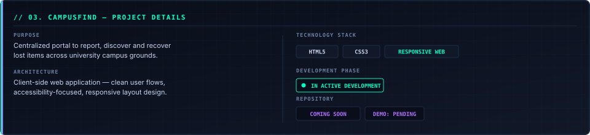
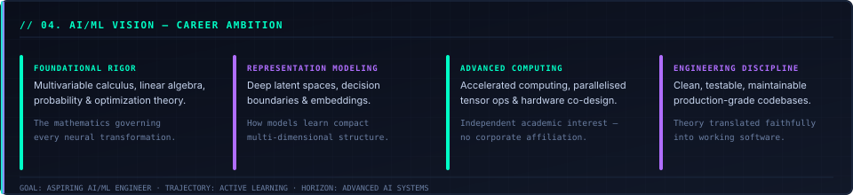

---

---

### // 02. TECHNICAL SKILLS

<table>
  <tr>
    <td align="center" width="180" height="120">
        
      <strong>Python</strong> 
      Core Syntax &amp; Scripting
    </td>
    <td align="center" width="180" height="120">
        
      <strong>C</strong> 
      Procedural &amp; Memory Basics
    </td>
    <td align="center" width="180" height="120">
        
      <strong>C++</strong> 
      OOP &amp; Data Structures
    </td>
    <td align="center" width="180" height="120">
        
      <strong>HTML5</strong> 
      Semantic Web Architecture
    </td>
    <td align="center" width="180" height="120">
        
      <strong>CSS3</strong> 
      Responsive Layouts &amp; Styling
    </td>
  </tr>
</table>

---

### // 03. FEATURED PROJECT — CAMPUSFIND

  

 

---

### // 04. MY AI/ML VISION

  

 

---

### // 05. AI/ML LEARNING ROADMAP

  

---

### // 06. GITHUB ANALYTICS

&nbsp;

  

---

### // 07. LET'S CONNECT &amp; BUILD SOMETHING MEANINGFUL

<table>
  <tr>
    <td align="center" width="280">
      <a href="mailto:anshuldh2025@gmail.com">
        <strong>EMAIL</strong> 
        <code>anshuldh2025@gmail.com</code>
      </a>
    </td>
    <td align="center" width="280">
      <a href="https://www.linkedin.com/in/anshul-dhiman-28959541a/">
        <strong>LINKEDIN</strong> 
        <code>in/anshul-dhiman-28959541a</code>
      </a>
    </td>
    <td align="center" width="280">
      <a href="https://github.com/anshuldh2025-eng">
        <strong>GITHUB</strong> 
        <code>github.com/anshuldh2025-eng</code>
      </a>
    </td>
  </tr>
</table>

 

  Designed for Anshul Dhiman · B.Tech CSE (AI &amp; ML) · Aspiring AI/ML Engineer

